# FuturePath

**Empowering South African Youth Through Education, Skills and Opportunity**

FuturePath is a free, full-stack youth empowerment platform built specifically for South Africa. It gives young people aged 14 to 38 the skills, certifications, job connections, and further education pathways they need to build sustainable careers — from any device, anywhere in the country.

> Built for the FNB App of the Year competition by **ZeroDay**.

---

## Live Demo

[https://futurepath-alpha.vercel.app](https://futurepath-alpha.vercel.app)

---

## Screenshots

### Home Page
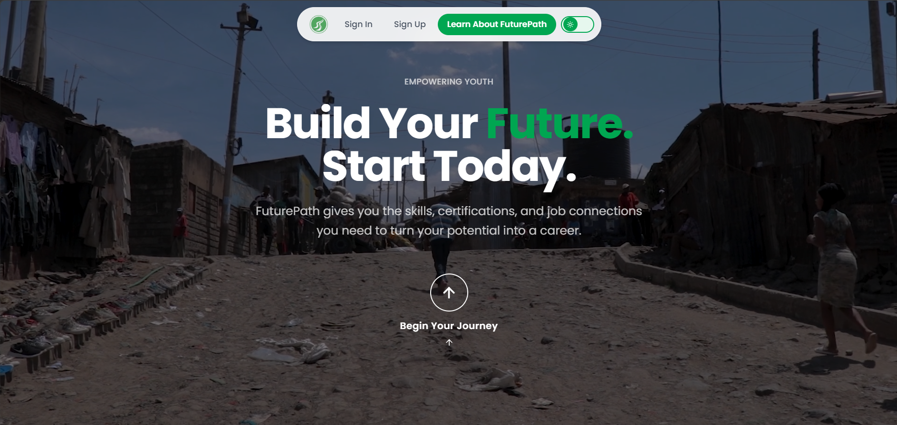

### Sign In
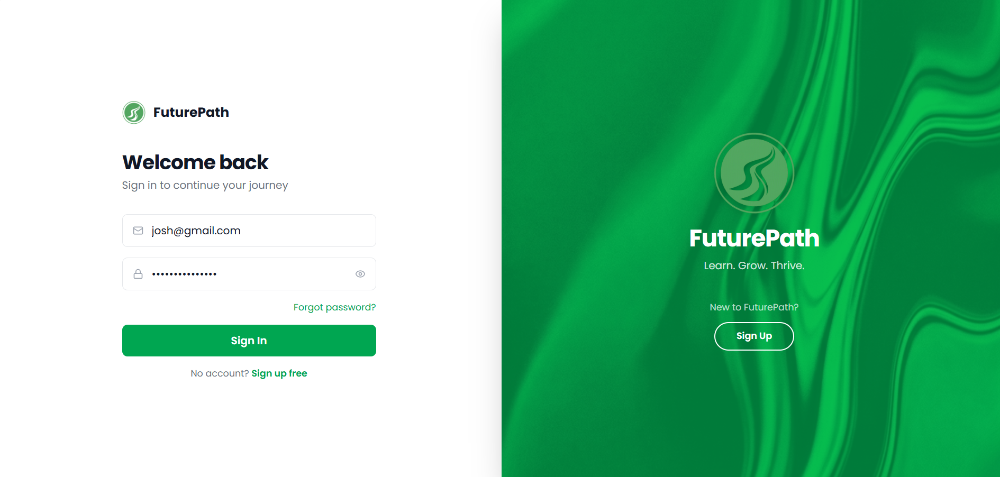

### Sign Up
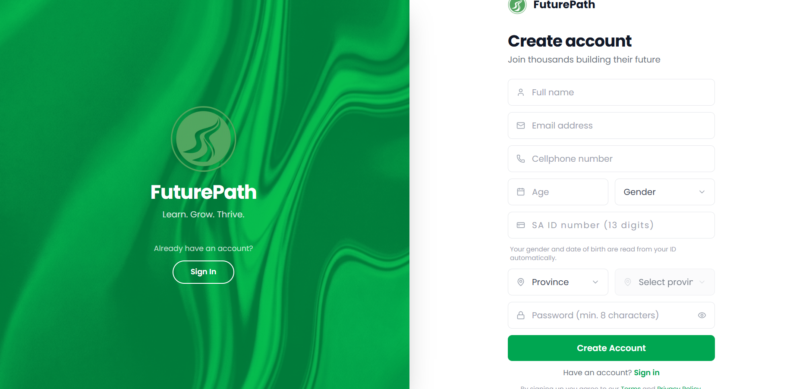

### Dashboard
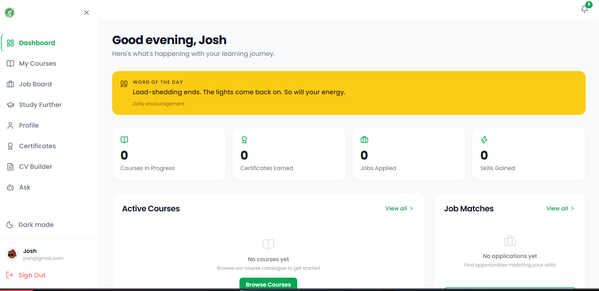

### Courses
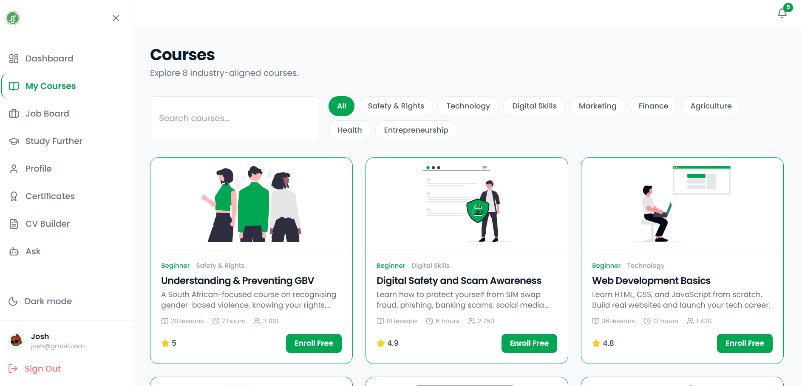

### Job Board
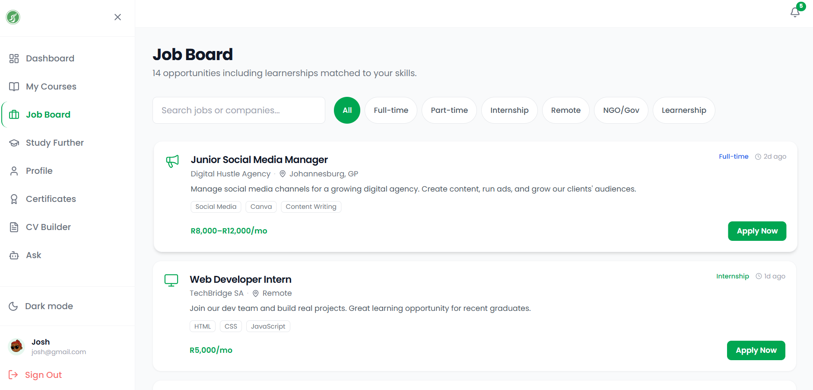

### Study Further
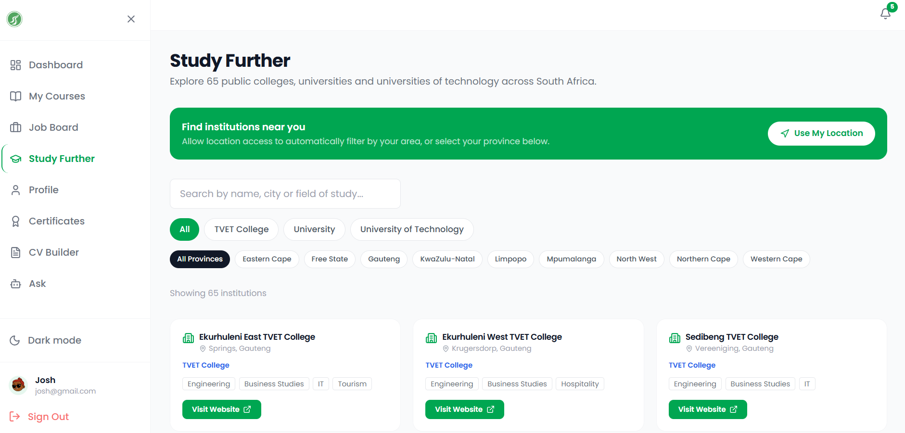

### Certificates
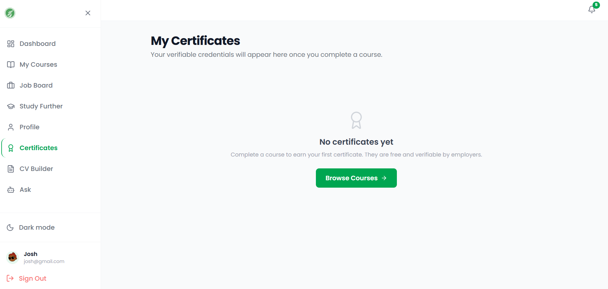

### CV Builder
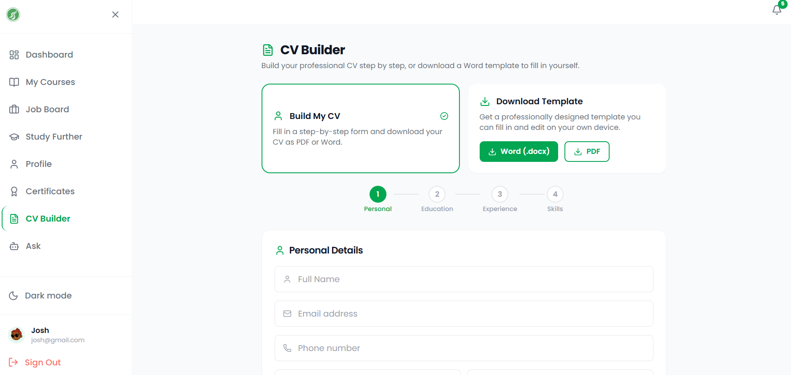

### Ask AI (Vuka)
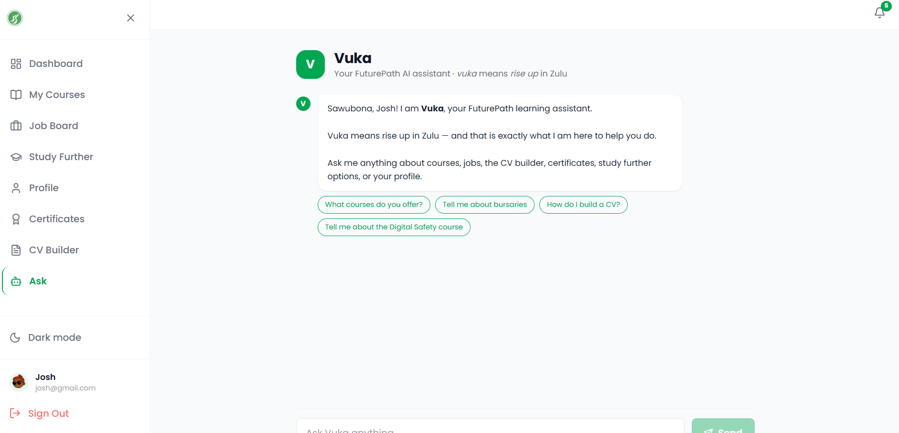

### Profile
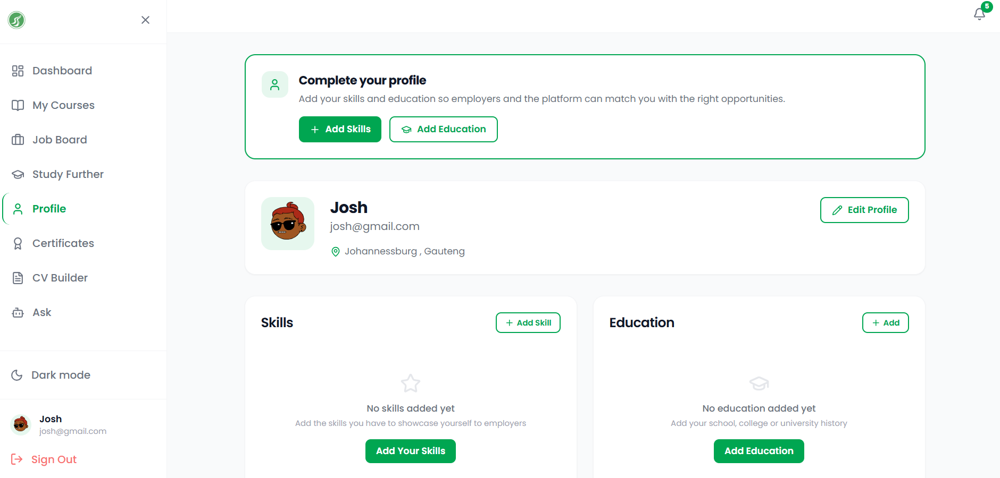

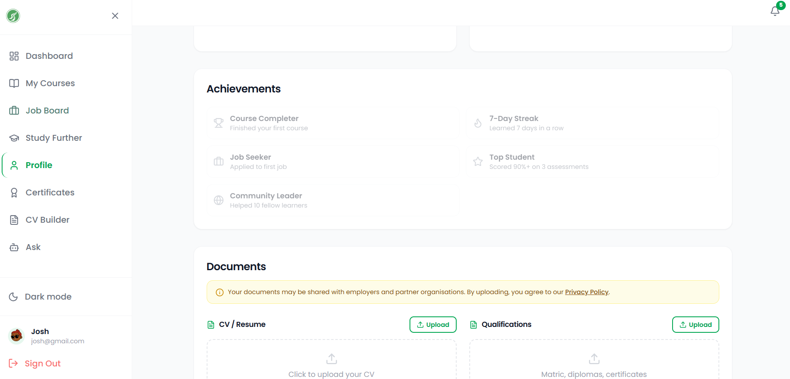

### Dark Mode
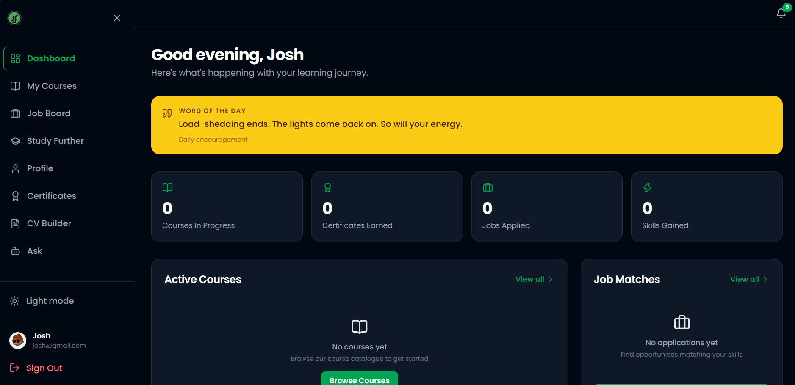

---

## Features

- **8 Free Courses** — GBV Awareness, Digital Safety and Scam Awareness, Web Development, Digital Marketing, Financial Literacy, Agribusiness, Community Health, Entrepreneurship
- **Job Board** — Curated job listings and SETA-registered learnerships filtered by skills and location
- **Verified Digital Certificates** — Auto-issued on course completion, verifiable by employers
- **CV Builder** — Guided 4-step form with PDF download and free professional template
- **Study Further** — Directory of all 39 TVET colleges, 19 universities and 6 universities of technology across South Africa, filtered by province
- **Bursaries** — Real SA bursaries including NSFAS, Sasol, Anglo American, Investec, Standard Bank, Nedbank, Eskom and more
- **Vuka AI Assistant** — In-platform AI chatbot trained on FuturePath content, named after the Zulu word for rise up
- **Admin Portal** — Full 8-tab admin dashboard for managing students, jobs, learnerships, bursaries, advertisements, and login history
- **Dark Mode** — System-aware with manual toggle
- **Location-Aware** — Province and city registration to surface nearby opportunities
- **SA ID Auto-fill** — Age and gender extracted automatically from the SA ID number
- **Word of the Day** — 160 plus daily motivational quotes from Mandela, Tutu, African proverbs and SA-specific encouragement

---

## Tech Stack

| Layer | Technology |
|---|---|
| Framework | Next.js 14 (App Router) |
| Language | TypeScript |
| Styling | Tailwind CSS |
| Animations | Framer Motion |
| Icons | Lucide React |
| Authentication | Firebase Auth |
| Database | Cloud Firestore |
| File Storage | Firebase Storage |
| Hosting | Vercel |
| AI Assistant | Custom NLU engine (no API, runs in browser) |
| CV Generation | Client-side PDF via print API |

---

## Project Structure

```
src/
  app/
    (app)/          # Authenticated app routes
      admin/        # Admin portal
      ask-ai/       # Vuka AI assistant
      certificates/ # User certificates
      courses/      # Course listing and detail pages
      cv-builder/   # CV builder
      dashboard/    # User dashboard
      jobs/         # Job board
      profile/      # User profile
      study-further/# Universities, colleges, bursaries
    about/          # About page
    auth/           # Login and registration
    contact/        # Contact page
    privacy/        # Privacy policy
    terms/          # Terms of service
  components/       # Shared components
  lib/              # Firebase, contexts, AI engine
```

---

## Getting Started

### Prerequisites
- Node.js 18 or higher
- A Firebase project with Auth and Firestore enabled

### Installation

```bash
git clone https://github.com/uwamimgxekwa/futurepath.git
cd futurepath
npm install
```

### Environment Variables

Create a `.env.local` file in the project root:

```
NEXT_PUBLIC_FIREBASE_API_KEY=your_api_key
NEXT_PUBLIC_FIREBASE_AUTH_DOMAIN=your_project.firebaseapp.com
NEXT_PUBLIC_FIREBASE_PROJECT_ID=your_project_id
NEXT_PUBLIC_FIREBASE_STORAGE_BUCKET=your_project.appspot.com
NEXT_PUBLIC_FIREBASE_MESSAGING_SENDER_ID=your_sender_id
NEXT_PUBLIC_FIREBASE_APP_ID=your_app_id
NEXT_PUBLIC_FIREBASE_MEASUREMENT_ID=G-XXXXXXXXXX
```

### Run Locally

```bash
npm run dev
```

Open [http://localhost:3000](http://localhost:3000)

---

## Firestore Collections

| Collection | Description |
|---|---|
| `users` | User profiles with role, province, skills, education |
| `progress` | Course enrollment and completion tracking |
| `certificates` | Issued certificates per user |
| `applications` | Job applications per user |

---

## Developer

**Uwami Mgxekwa**
Full-Stack Developer and Founder of ZeroDay

Website: [uwamimgxekwa.com](https://uwamimgxekwa.com)

---

## Team

**ZeroDay**
A South African software development team building technology that creates real impact.

---

## License

This project is private and proprietary. All rights reserved.

&copy; 2026 FuturePath. Built with purpose for South Africa.
